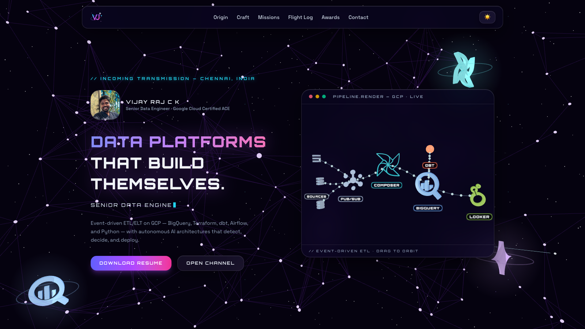
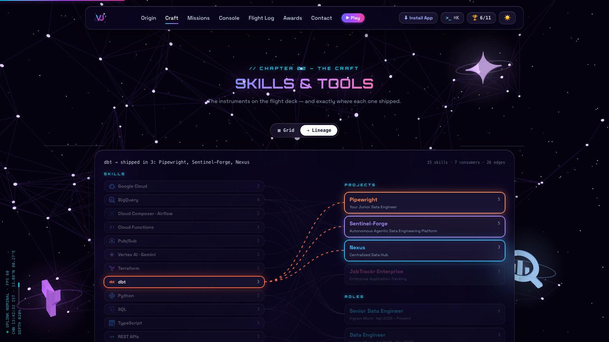
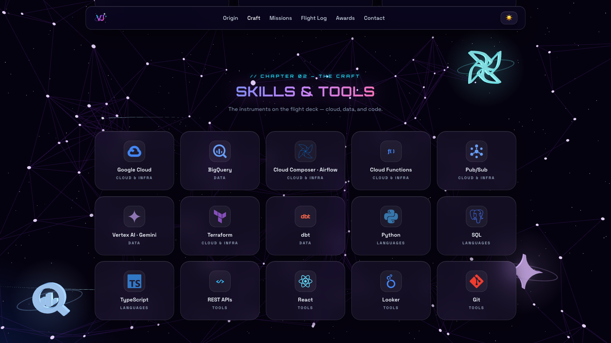
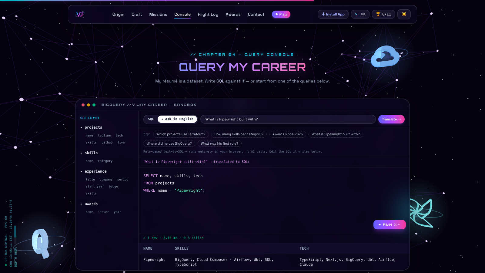
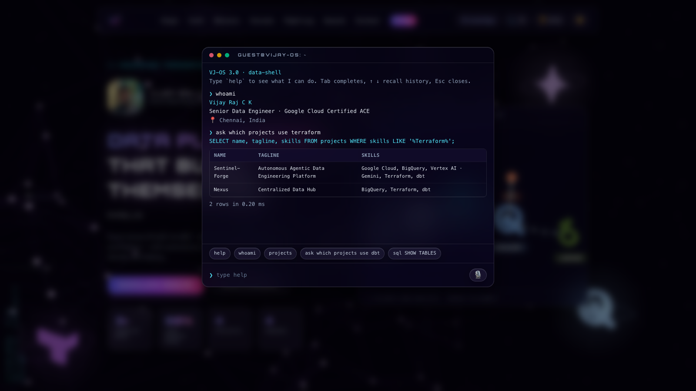
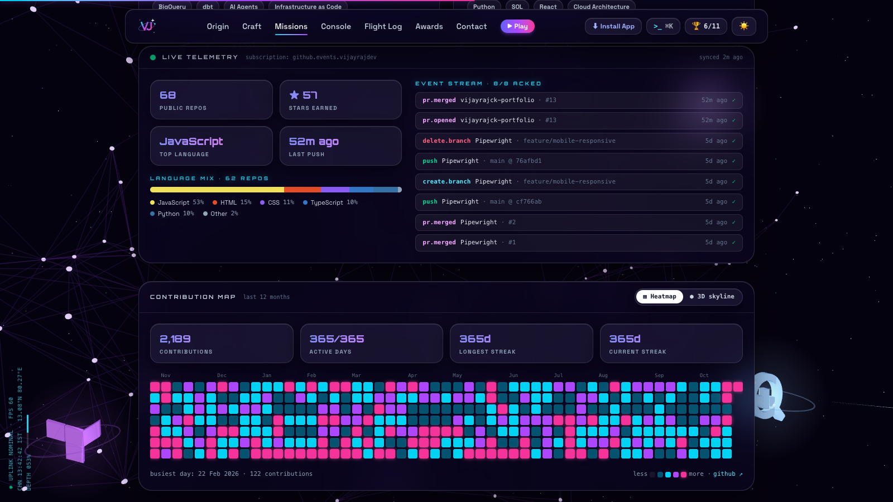
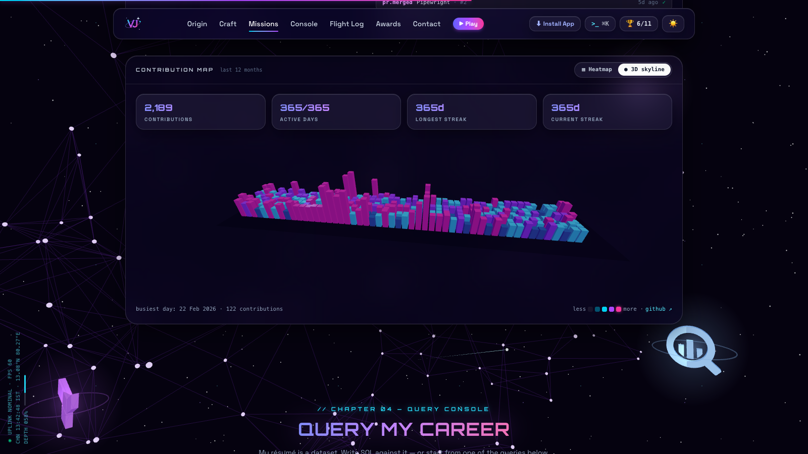
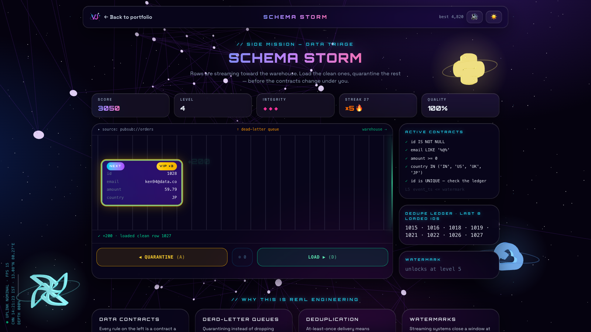
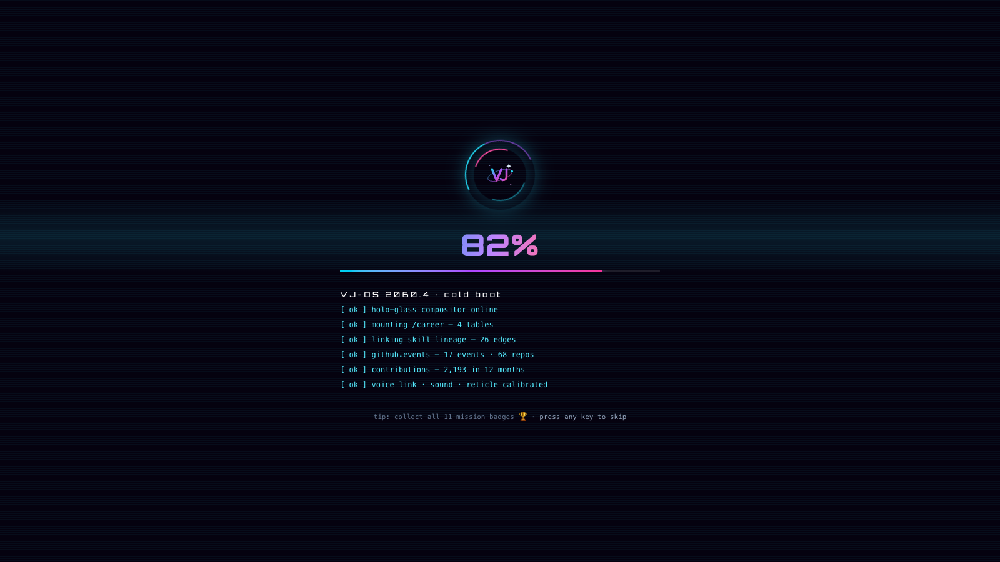
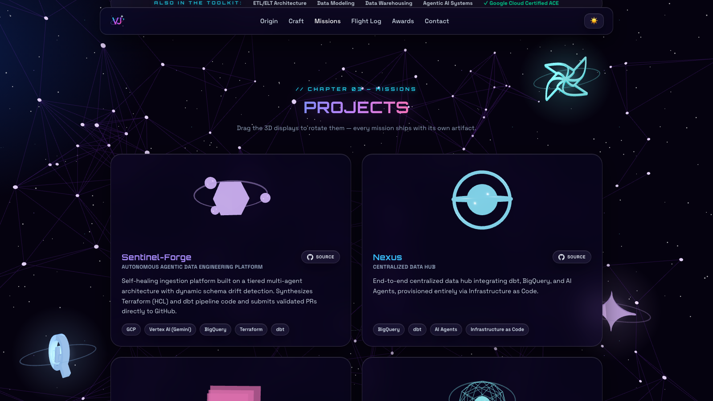

<div align="center">


# VIJAY RAJ C K — PORTFOLIO

**`// INCOMING TRANSMISSION — CHENNAI, INDIA`**

*A space-themed 3D portfolio for a Senior Data Engineer — built like a data platform.
Query the résumé in SQL, trace skill lineage, watch live GitHub telemetry, and play a data game.*

[](https://vijayrajck.vercel.app)
[](https://vijayrajck.vercel.app/play)




</div>

---

## `// CHAPTER 01 — WHAT IS THIS`

A portfolio that tells a story in chapters — **Origin → Craft → Missions → Query
Console → Flight Log → Awards → Transmission** — floating as glass panels over a
living deep-space scene: a particle pipeline network, starfield, comets, and real
product logos (BigQuery, Vertex AI, Terraform, Google Cloud, Python, Composer)
extruded into 3D. Plus a side mission at [`/play`](https://vijayrajck.vercel.app/play).

The hero is a **live 3D render of a GCP data pipeline**, built from the actual
product marks, with event particles flowing through glowing tubes:

```
              ╭──────────╮
SOURCES ══▶ PUB/SUB ══▶ COMPOSER ══▶ BIGQUERY ⇄ DBT
                                        ║
                                        ╚══▶ LOOKER
```

Drag it to orbit. It snaps home when released.

## `// CHAPTER 02 — INTERACTIVE SYSTEMS`

Everything here is something a visitor *does*, and every one of them is a data
engineering idea in disguise.

### ⇢ Skill lineage



The skills section flips between a filterable **grid** and a **lineage graph** in
the style of dbt docs: every skill feeds the projects and roles it actually
shipped in. Hover or tap a node to light its edges, with data flowing along them.
The edges aren't hand-drawn — they're derived by matching each skill's aliases
against project and role text ([`lineage.js`](src/data/lineage.js)), so the graph
redraws itself when the content changes.



### ⌘ Query Console — SQL or plain English



The résumé is a dataset. Visitors query `projects`, `skills`, `experience` and
`awards` with a syntax-highlighted editor, schema explorer and preset queries —
or switch to **Ask in English** and type *"Which projects use Terraform?"*.

- **[`miniSql.js`](src/utils/miniSql.js)** — a dependency-free SQL engine:
  `WHERE`, `LIKE`, `IN`, `IS NULL`, `AND/OR/NOT`, `GROUP BY` + `COUNT(*)`,
  `ORDER BY`, `LIMIT`, `DISTINCT`, `SHOW TABLES`, `DESCRIBE`, with friendly errors
  (`DROP TABLE` gets *"this warehouse is read-only"*).
- **[`textToSql.js`](src/utils/textToSql.js)** — rule-based text-to-SQL. No model,
  no network: it picks the table, filters, years, ordering and counts from the
  question, writes the SQL into the editor so you can see the translation, and runs it.

### `>_` The terminal — now with voice



`⌘K` / `Ctrl K` / <code>`</code> opens **VJ-OS**: `help`, `whoami`, `projects`,
`open <name>`, `goto <section>`, `sql <query>`, `ask <question>`, `resume`,
`theme`, `play` — with tab completion, history, tap-to-run chips on phones, and a
few easter eggs.

**Voice mode** (Chrome, Edge, Safari — Web Speech API): tap 🎙 and just talk.
A **live transcript** streams in as you speak, the command runs, the terminal
**answers out loud** (*"Found 3: Pipewright, Sentinel-Forge and Nexus."*), then
listens for the next one — hands-free until you tap 🎙 again. The mic pauses while
it speaks, so it never transcribes itself.

### ◉ Live telemetry & contribution map



Public GitHub activity replayed as a **Pub/Sub-style message stream** — each event
"acked" as it arrives — with repo, star and language stats, and live
`language · ★ stars · pushed 5d ago` badges on the project cards whose repos are
public. Below it, the **contribution map**: a year of commits as a heatmap
(coloured by quartile of active days, similar to GitHub's), with streak stats — or
as a rotating **3D skyline**, one instanced tower per day.



### ▶ Schema Storm — the data game (`/play`)



Rows ride a conveyor toward the warehouse — left to right on desktop, top to
bottom on phones. **Load** the clean ones, **quarantine** the rest to the
dead-letter queue — before they hit the gate. Every level adds a data contract,
and sometimes a column (schema drift): `id IS NOT NULL`, `email LIKE '%@%'`,
`amount >= 0`, `country IN (…)`, duplicate ids against a dedupe ledger, and late
events past a watermark. Three mistakes halt the pipeline.

What makes it a game, not a quiz:

- **Sound** — a synthesised score (Web Audio, zero files): chimes for loads,
  thunks for quarantines, a buzz for mistakes, level-up arpeggios and a bass pulse
  that speeds up every level. `M` or 🔊 mutes.
- **3 · 2 · 1 · GO** countdown, **score pop-ups** and particle bursts where each
  row was, **screen shake** and a red flash on mistakes (plus a vibration on Android).
- **Streak multiplier** up to ×5 (🔥 from ×4), **VIP ×3** rows in gold, a
  **perfect-level bonus** for clearing a level with no mistakes.
- **❄ Backfill freeze** — every 10-streak earns a charge (hold up to 2); `F` / `Space` slows the
  belt to 35% for 5 seconds.
- **Leaderboard** — your top 5 runs on this device.

Controls: ← / → or A / D, touch buttons on phones, `P` to pause.

The rules live in a React-free module ([`schemaStorm.js`](src/game/schemaStorm.js))
and are property-tested: across 21,000 generated rows, every broken row fails
exactly the one contract it was built to break. A bot reading only what's on
screen played through level 6 without a mistake — so every call is fair.

### 🏆 Mission badges & the 2060 layer

- **11 badges** for exploring — open the terminal, run your own SQL, ask in
  English, trace lineage, catch the telemetry, use your voice, visit every
  chapter, find the secret command, score 500+ in Schema Storm… with unlock toasts
  and a progress panel in the nav.
- A **5-second loading screen** on every page load — and it's never idle: while
  it runs it fetches the GitHub telemetry and contribution data, and the boot log
  reports what actually came back. Any key or tap skips it.
- A **HUD** running up the left edge (fps, Chennai time, uplink, scroll depth), a
  **targeting reticle** that locks onto controls, a **scroll-progress bar** and
  active-section nav, pointer-tracked **spotlight and 3D tilt** on cards, and
  count-up hero stats.



<div align="center">

</div>

## `// CHAPTER 03 — FLIGHT SYSTEMS`

| System | What it does |
| --- | --- |
| **Two WebGL contexts, total** | One background canvas + one shared overlay canvas rendering the pipeline, every project stage and the contribution skyline as scissored drei `<View>`s — immune to browser context-loss |
| **FrostGL** | macOS-grade glassmorphism on every OS: where `backdrop-filter` can't be trusted (most Windows/Linux GPU configs), the background scene is gaussian-blurred in WebGL and composited back under each glass panel's rounded rect, tracked live from the DOM (fixed nav first, unrevealed panels skipped) |
| **Capability ladder** | Real GPU → native blur or FrostGL · software GPU → CSS frost plate · no WebGL at all → CSS starfield + designed DOM fallbacks. Nobody sees an empty box |
| **Live data, politely** | GitHub REST (cached 10 minutes) and a public contributions API (cached for the session) in `sessionStorage`, prefetched during the loading screen, with offline/rate-limit messages instead of blank panels |
| **Motion with manners** | Interface animations — boot, reticle, tilt, flowing edges, belts, pop-ups, toasts — respect `prefers-reduced-motion`, and tilt and reticle only run on precise pointers. The 3D scenes (background, pipeline, project models, skyline) keep moving |
| **Frost-plate safe** | On machines without GPU blur, the frost fallback keeps absolutely/fixed-positioned glass (game cards, badge panel) where it belongs |
| **Route-split** | `/play` is lazy-loaded, so the game costs the portfolio nothing until someone opens it |
| **PWA** | Installable, offline-capable, custom VJ monogram as app icon, self-hosted fonts |

## `// CHAPTER 04 — LAUNCH SEQUENCE`

```bash
npm install      # fuel
npm run dev      # ignition — local dev server (http://localhost:5173, game at /play)
npm run lint     # pre-flight checks (oxlint)
npm run build    # orbit — production build → dist/
npm run preview  # test the production build locally
```

**Debug switches:** `?frostgl=1` / `?frostgl=0` force the WebGL frost on/off ·
`?boot=0` skips the loading screen (its length is `BOOT_MS` in
[`Future.jsx`](src/components/Future.jsx)). The console prints
`[vj-portfolio] webgl=… frostgl=… backdrop=…` on every load.

## `// CHAPTER 05 — MISSION CONTROL`

All content is data, not markup. Edit these and the site rebuilds itself:

| File | Controls |
| --- | --- |
| [`src/data/portfolio.js`](src/data/portfolio.js) | Profile, hero stats, story, experience, projects, awards |
| [`src/data/skills.js`](src/data/skills.js) | Skill tiles, brand logos, and the aliases that drive lineage |
| [`src/data/lineage.js`](src/data/lineage.js) | Skill → project/role edges (derived — no hand edits) |
| [`src/data/tables.js`](src/data/tables.js) | Query Console tables (derived) + preset queries |
| [`src/game/schemaStorm.js`](src/game/schemaStorm.js) | Schema Storm contracts, levels, pacing and leaderboard |
| [`src/game/sfx.js`](src/game/sfx.js) | Schema Storm sound effects and bass pulse |
| [`src/utils/achievements.js`](src/utils/achievements.js) | Mission badges |
| [`src/data/logos3d.js`](src/data/logos3d.js) | The floating 3D logo pool |
| [`src/data/socials.js`](src/data/socials.js) | Contact / social marks |

## `// CHAPTER 06 — DEPLOYMENT`

Static output in `dist/` — deploys anywhere. On Vercel: preset **Vite**,
build `npm run build`, output `dist`. Every push to `master` auto-deploys.
[`vercel.json`](vercel.json) rewrites `/play` to the app so the game URL works on
a direct visit or refresh; on other hosts, add the same SPA fallback.

---

<div align="center">

**`// END OF TRANSMISSION`**

Built with React, Three.js & Tailwind CSS ·
Made with ❤️ by [Vijay](https://www.linkedin.com/in/vijay-raj-02)

Code is [MIT licensed](LICENSE) — fork it as a template for your own portfolio.
Personal photos, resume, and the VJ mark are excluded (see LICENSE).

[](https://www.linkedin.com/in/vijay-raj-02)
[](https://github.com/Vijayrajdev)
[](mailto:vijayrajck2@gmail.com)

</div>
